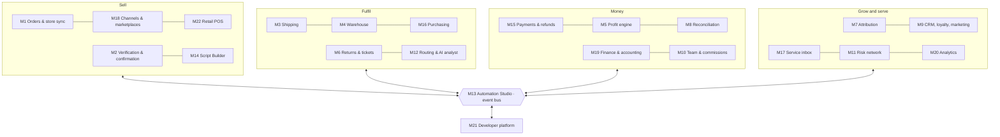
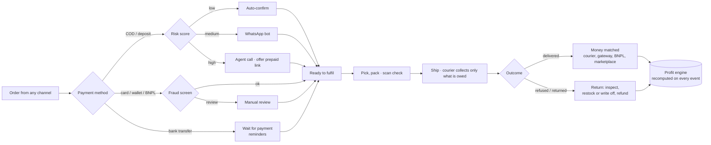

# 02 — Product

> Scope, domains, modules, phases and the core lifecycles. Each module has a full spec in `docs/modules/`. Payments: `docs/12-payments.md`. Automations: `docs/13-automation-platform.md`.

## 1. What Mizan is

The complete commerce operating system for MENA brands: every channel, every payment method, every operation from checkout to the books, connected by one event bus and Automation Studio.

## 2. Domains and modules

| ID | Module | Arabic | Domain | Phase | Spec |
| --- | --- | --- | --- | --- | --- |
| M1 | Orders and store sync | الأوردرات وربط المتاجر | Sell | MVP | [M01](modules/M01-orders-store-sync.md) |
| M2 | Order verification and confirmation | التحقق من الأوردرات وتأكيدها | Sell | MVP | [M02](modules/M02-smart-confirmation.md) |
| M3 | Shipping and couriers | الشحن وشركات الشحن | Fulfil | MVP | [M03](modules/M03-shipping-couriers.md) |
| M4 | Warehouse and inventory | المخزن والمخزون | Fulfil | MVP | [M04](modules/M04-warehouse-inventory.md) |
| M5 | Profit engine | محرك الربح | Money | MVP | [M05](modules/M05-profit-engine.md) |
| M6 | Returns, exchanges and tickets | المرتجعات والاستبدال | Fulfil | MVP | [M06](modules/M06-returns-tickets.md) |
| M7 | Ad-to-cash attribution | ربط الإعلانات بالكاش | Grow | V2 | [M07](modules/M07-ad-to-cash-attribution.md) |
| M8 | Cash and payment reconciliation | تسوية الكاش والمدفوعات | Money | V2 | [M08](modules/M08-payment-reconciliation.md) |
| M9 | CRM, loyalty and marketing automation | العملاء والولاء والتسويق الآلي | Grow | V2 | [M09](modules/M09-crm-retention.md) |
| M10 | Team performance and commissions | أداء الفريق والعمولات | Money | V2 | [M10](modules/M10-agent-performance.md) |
| M11 | Regional risk network | شبكة المخاطر | Grow | V3 | [M11](modules/M11-regional-risk-network.md) |
| M12 | Courier routing and AI analyst | توجيه الشحن والمحلل الذكي | Fulfil | V3 | [M12](modules/M12-routing-ai-analyst.md) |
| M13 | Automation Studio — **the backbone** | استوديو الأتمتة | Platform | MVP core · V2 builder | [M13](modules/M13-automation-studio.md) |
| M14 | Script Builder | منشئ السكريبتات | Sell | MVP · grows in V2 | [M14](modules/M14-script-builder.md) |
| M15 | Payments and refunds | المدفوعات والاسترداد | Money | MVP | [M15](modules/M15-payments-refunds.md) |
| M16 | Purchasing and suppliers | المشتريات والموردين | Fulfil | V2 | [M16](modules/M16-purchasing-suppliers.md) |
| M17 | Customer service inbox | صندوق خدمة العملاء | Grow | V2 | [M17](modules/M17-customer-service-inbox.md) |
| M18 | Sales channels and marketplaces | قنوات البيع والماركت بليس | Sell | V2 | [M18](modules/M18-sales-channels-marketplaces.md) |
| M19 | Finance and accounting | المالية والحسابات | Money | V2 | [M19](modules/M19-finance-accounting.md) |
| M20 | Analytics and reports | التحليلات والتقارير | Grow | MVP core · V2 builder | [M20](modules/M20-analytics-reports.md) |
| M21 | Developer platform and app integrations | منصة المطورين والتكاملات | Platform | V2 | [M21](modules/M21-developer-platform.md) |
| M22 | Retail POS | نقاط البيع للمحلات | Sell | V3 | [M22](modules/M22-retail-pos.md) |

**Not in scope:** manufacturing and bills of materials beyond simple kits, payroll calculation (imported into M19), a full general ledger (Mizan syncs to accounting tools), holding customer funds.

## 3. Lifecycles

### 3.1 Order lifecycle (any payment method)

**Profit per order** = revenue − refunds − COGS − shipping − COD fee − payment/BNPL fee − channel fee − ads − team cost − packaging − RTO − chargebacks.

### 3.2 Money lifecycle

Expected (order) → collected (courier, gateway, BNPL, marketplace, bank) → paid out to the merchant → matched (M8) → posted (M5, M19). See `docs/12-payments.md`.

### 3.3 Stock lifecycle

Purchased (M16) → received (scan) → available → reserved (confirmed order) → picked → shipped → returned → restocked or written off. One count across store, marketplaces and shops.

### 3.4 Order statuses

Merchants may add their own statuses, each mapped to a core status so reports and profit stay correct.

| Core status | Meaning |
| --- | --- |
| `new` | Synced and normalized |
| `pending_confirmation` | Waiting on verification (confirmation, fraud review or payment) |
| `confirmed` | Ready to fulfil |
| `cancelled` | Cancelled by customer, agent or rules |
| `shipped` | Handed to the courier |
| `delivered` | Courier reports delivered (or picked up / handed over at POS) |
| `returned` | Back at the warehouse |

Payment status is separate (`unpaid`, `authorized`, `partially_paid`, `paid`, `partially_refunded`, `refunded`, `disputed`, `failed`, `voided`) — see `docs/12-payments.md`.

## 4. Phases

| Phase | Months | Modules |
| --- | --- | --- |
| **MVP** | 1–5 | M1, M2, M3, M4, M5, M6, M15, M13 core (recipes), M14 basic, M20 core (built-in dashboards) |
| **Pilot** | 5–7 | Harden; measure; first case studies |
| **V2** | 7–12 | M7, M8, M9, M10, M16, M17, M18, M19, M21, M13 visual builder, M14 A/B + dialects, M20 builder; KSA stack |
| **V3** | 12–18 | M11, M12, M22; Maghreb and Levant |

## 5. MVP requirements summary

| Module | Must do | Acceptance |
| --- | --- | --- |
| M1 | Two-way sync (Shopify, WooCommerce, EasyOrders, LightFunnels first); payment mode and status on every order; duplicate check; bulk actions; activity log | New Shopify order visible within 60 s with correct items, price and payment status |
| M2 | Risk score 0–100 with reasons; COD → auto / bot / agent / hold; prepaid → fraud screen; bank transfer → wait | Rate shown per route; no unpaid bank transfer reaches packing |
| M3 | Create, label, track, cancel, pickup; COD amount from M15; scorecard per zone | Courier collects exactly what is owed for every method (tested) |
| M4 | Multi-warehouse stock; scan to pick and pack; offline queue; oversell block | Wrong-SKU scan blocks packing; offline scans sync once |
| M5 | P&L per order with method-specific fees, refunds, chargebacks; daily FX | Net profit for yesterday and 30 days on the home screen |
| M6 | Complaints, exchanges, refunds, delivery issues; open-box; inspection | Every return is restocked or written off; refunds settle through M15 |
| M15 | Payment ledger; payment links (full, deposit, COD-to-prepaid); refunds; chargebacks; Paymob first | Ledger sums to balance on every order; no card data stored |
| M13 core | Recipe runtime across modules, run log, loop guard | Recipe runs once per event; dry-run sends nothing |
| M14 basic | Confirmation scripts with variables, Egyptian dialect | Preview with real order data |
| M20 core | Built-in dashboards (home, ops, profit, payments, stock); exports | Same metric, same value on every screen |

## 6. Non-functional requirements

| Area | Requirement |
| --- | --- |
| Performance | Order list (50 rows, filters) < 500 ms p95; webhook ack < 200 ms p95 |
| Freshness | New order < 60 s; payment status < 2 min; courier status < 30 min (webhook) or ≤ 5 min after poll; stock to channels < 15 min |
| Correctness | No duplicate shipments, fulfilments or refunds; courier cash = amount owed; no lost updates (engine chaos-tested) |
| Availability | 99.5% monthly at launch; 99.9% after V2 |
| Data safety | Daily backups + PITR; RPO ≤ 15 min, RTO ≤ 4 h; restore tested monthly |
| Scale (MVP) | 200 tenants, 1M orders/month total |
| Languages | Arabic (Egyptian UI copy) and English, RTL first-class; Gulf, Darija, Levantine, Iraqi in scripts |
| Offline | Ops and POS apps work a full shift offline; sync exactly once |
| Payments security | No card data stored, processed or logged (hosted pages only) |
| Accessibility | WCAG 2.2 AA contrast; keyboard navigation |
| Devices | Web: last 2 versions of Chrome, Safari, Edge; 360 px mobile web. Apps: Android 9+, iOS 16+ |

## 7. Roles and permissions

| Role | Arabic | Typical access |
| --- | --- | --- |
| Owner | صاحب البيزنس | Everything, billing, integrations, refunds above threshold |
| Admin | أدمن | Everything except billing and tenant delete |
| Ops manager | مدير العمليات | Orders, verification, shipping, warehouse, purchasing, returns, inbox |
| Agent | موظف تأكيد / خدمة عملاء | Own queue, inbox, scripts (read), payment links |
| Warehouse | المخزن | Pick, pack, receive, counts, inspections |
| Finance | الحسابات | Payments, refunds, reconciliation, profit, finance, exports |
| Media buyer | ميديا باير | Attribution and ad reports |
| Cashier | كاشير | POS sales and returns (V3) |

## 8. Metrics instrumented from day one

Product events (IDs only, never PII; ✅ E4-5: table `product_events`, milestones recorded once; time-to-first-value = `signup` → `first_order_synced`, in `GET /v1/onboarding` and the `mizan_time_to_first_value_seconds` histogram): `signup`, `costs_entered`, `onboarding_step_skipped`, `store_connected`, `courier_connected`, `gateway_connected`, `whatsapp_connected`, `first_order_synced`, `first_order_verified`, `first_shipment_created`, `first_payment_link_paid`, `recipe_enabled`, `script_published`, `report_scheduled`, `plan_upgraded`, `module_activated`.
