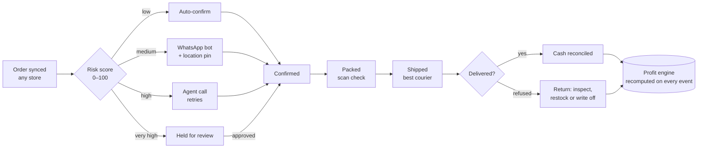

# 02 — Product

> Scope, modules, phases and the core order lifecycle. Each module has a full spec in `docs/modules/`.

## 1. Product scope

Fourteen modules in three phases. The MVP matches the core of existing COD tools and adds the profit engine on day one.

| ID | Module | Arabic | Phase | Spec |
| --- | --- | --- | --- | --- |
| M1 | Orders and store sync | الأوردرات وربط المتاجر | MVP | [M01](modules/M01-orders-store-sync.md) |
| M2 | Smart confirmation | التأكيد الذكي | MVP | [M02](modules/M02-smart-confirmation.md) |
| M3 | Shipping and couriers | الشحن وشركات الشحن | MVP | [M03](modules/M03-shipping-couriers.md) |
| M4 | Warehouse and inventory (offline) | المخزن والمخزون | MVP | [M04](modules/M04-warehouse-inventory.md) |
| M5 | Profit engine — **the edge** | محرك الربح | MVP | [M05](modules/M05-profit-engine.md) |
| M6 | Returns, exchanges and tickets | المرتجعات والاستبدال | MVP | [M06](modules/M06-returns-tickets.md) |
| M7 | Ad-to-cash attribution — **the moat** | ربط الإعلانات بالكاش | V2 | [M07](modules/M07-ad-to-cash-attribution.md) |
| M8 | COD cash reconciliation | تسوية الكاش | V2 | [M08](modules/M08-cod-cash-reconciliation.md) |
| M9 | CRM and retention | العملاء والاحتفاظ | V2 | [M09](modules/M09-crm-retention.md) |
| M10 | Agent performance and commissions | أداء الموظفين والعمولات | V2 | [M10](modules/M10-agent-performance.md) |
| M11 | Regional risk network | شبكة المخاطر | V3 | [M11](modules/M11-regional-risk-network.md) |
| M12 | Courier routing and AI analyst | توجيه الشحن والمحلل الذكي | V3 | [M12](modules/M12-routing-ai-analyst.md) |
| M13 | Automation Studio | استوديو الأتمتة | MVP core · V2 builder | [M13](modules/M13-automation-studio.md) |
| M14 | Script Builder | منشئ السكريبتات | MVP · grows in V2 | [M14](modules/M14-script-builder.md) |

**Out of scope for now:** POS, purchase orders, marketplace selling, a full accounting ledger (Mizan exports to Zoho Books, Odoo, CSV).

## 2. The order lifecycle

Only confirmed orders ship, and every outcome lands in profit.

**Profit per order** = revenue − COGS − shipping − COD fee − payment fee − ads (attributed) − agent cost − RTO cost (both legs + write-off).

### 2.1 Core order statuses

Merchants may add their own statuses, but each must map to one of these so profit and reports stay correct.

| Core status | Meaning |
| --- | --- |
| `new` | Synced and normalized, not yet scored |
| `pending_confirmation` | Waiting on bot, agent or customer |
| `confirmed` | Customer confirmed; ready to pack |
| `cancelled` | Cancelled by customer, agent or rules |
| `shipped` | Handed to the courier (shipment exists) |
| `delivered` | Courier reports delivered |
| `returned` | Back at the warehouse (RTO or return) |

Shipment statuses come from the engine (`packages/engine/src/core/model.ts`): `created`, `pickup_requested`, `picked_up`, `in_transit`, `out_for_delivery`, `failed_attempt`, `delivered`, `returning`, `returned`, `cancelled`, `lost`, `unknown`.

## 3. Requirements summary — MVP (months 1–4)

| Module | Must do | Acceptance |
| --- | --- | --- |
| M1 | Two-way sync (Shopify, WooCommerce, EasyOrders, LightFunnels first); configurable statuses; duplicate check (phone + product + 48 h); bulk confirm / assign / print / ship; activity log | New Shopify order visible within 60 s with correct items and price |
| M2 | Risk score 0–100; route to auto, WhatsApp bot, agent or hold; confirm / change / cancel buttons + location pin; agent queue with click-to-call and retries | Confirmation rate shown separately for auto, bot and agent |
| M3 | Create, label, track, cancel, pickup; courier codes → Mizan statuses; scorecard per zone; branded labels A6/A4 | One click books and labels; status updates within 30 min |
| M4 | Multi-warehouse stock (on hand, reserved, available); scan to pick and pack; offline queue; oversell block | Wrong-SKU scan blocks packing; offline scans sync once |
| M5 | P&L per order; RTO charged to its order; views by product, store, country, courier; daily FX | Net profit for yesterday and 30 days on the home screen |
| M6 | Complaint, exchange, refund, delivery issue; open-box (المعاينة) and partial delivery; inspection outcome | Every return is restocked or written off, and costed |
| M13 core | Built-in recipes (When → If → Then), on/off per tenant | Recipe runs once per event; run log visible |
| M14 basic | Confirmation scripts per dialect with variables | Script preview with real order data |

V2 and V3 requirements: see each module spec.

## 4. Non-functional requirements

| Area | Requirement |
| --- | --- |
| Performance | Order list (50 rows, filters) < 500 ms p95; webhook ack < 200 ms p95 |
| Freshness | New order visible < 60 s; courier status < 30 min (webhook) or ≤ 5 min after poll |
| Availability | 99.5% monthly at launch; 99.9% target after V2 |
| Data safety | Daily backups + PITR; restore tested monthly; RPO ≤ 15 min, RTO ≤ 4 h |
| Scale (MVP) | 200 tenants, 1M orders/month total, without architecture change |
| Languages | Arabic (Egyptian for UI copy) and English, RTL first-class; Gulf/Darija/Levantine/Iraqi in scripts |
| Offline | Ops app works for a full shift without network; sync is exactly-once |
| Accessibility | WCAG 2.2 AA contrast; keyboard navigation in web dashboard |
| Devices | Web: last 2 versions of Chrome, Safari, Edge; mobile web 360 px wide. Ops app: Android 9+, iOS 16+ |

## 5. Roles and permissions

| Role | Arabic | Typical access |
| --- | --- | --- |
| Owner | صاحب البيزنس | Everything, billing, integrations, delete |
| Admin | أدمن | Everything except billing and tenant delete |
| Ops manager | مدير العمليات | Orders, confirmation, shipping, warehouse, returns |
| Agent | موظف تأكيد | Own queue, customer contact, scripts (read) |
| Warehouse | المخزن | Pick, pack, stock counts, returns inspection |
| Finance | الحسابات | Profit, cash, settlements, exports |
| Media buyer | ميديا باير | Attribution and ad reports (V2) |

Permission matrices per module are in each module spec (F = full, P = partial, - = none).

## 6. Metrics instrumented from day one

Product events (send to analytics with `tenant_id`, never PII): `signup`, `store_connected`, `courier_connected`, `whatsapp_connected`, `first_order_synced`, `first_order_confirmed`, `first_shipment_created`, `plan_upgraded`, `recipe_enabled`, `script_published`.

Merchant outcome metrics are computed from operational data (see `docs/01-business-model.md` §12).
