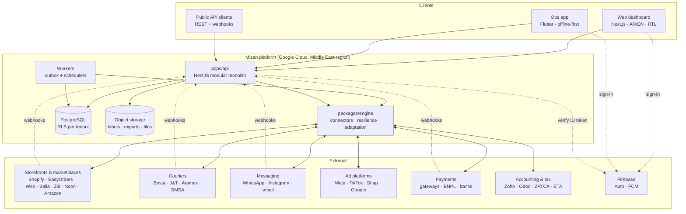

# 03 — Architecture

## 1. System context



## 2. Deployables

| Unit | Code | Runs | Scales by |
| --- | --- | --- | --- |
| API | `apps/api` (`main.ts`) | Cloud Run service, ≥ 2 instances | Requests |
| Worker | `apps/api` (`worker.ts`, same image, different entry) | Cloud Run service, always-on, ≥ 1 | Outbox backlog |
| Scheduler | Cloud Scheduler → `POST /internal/cron/*` on the worker | — | — |
| Web | `apps/web` | Cloud Run (or Vercel if preferred; keep ME data residency for APIs) | Requests |
| Ops app (warehouse, agents, POS in V3) | `apps/ops` | Play Store / App Store; internal testing tracks first | — |
| Database | Cloud SQL for PostgreSQL 16+, HA, PITR | ME region | Vertical first, read replica for reports |

One image, two entry points, keeps the modular monolith simple: the API never runs long jobs; the worker never serves user traffic.

## 3. Modular monolith layout (`apps/api`)

```
apps/api/src/
  main.ts                 HTTP entry
  worker.ts               outbox worker + cron handlers
  platform/               cross-cutting
    auth/                 Firebase ID token guard, API keys, roles
    tenancy/              tenant resolution, RLS session (SET app.tenant_id)
    db/                   Kysely/Drizzle client, migrations runner, transactions
    events/               domain event bus (in-process) + outbox writer
    i18n/                 server-side messages (AR/EN)
    audit/                append-only audit log
    secrets/              encrypt/decrypt credentials (Cloud KMS envelope)
    http/                 error filter, problem+json, pagination, idempotency-key middleware
  modules/
    tenants/  users/  billing/
    connections/          store + courier + WhatsApp + ad account connections (OAuth, keys)
    orders/       (M1)    verification/ (M2)   shipping/ (M3)    warehouse/ (M4)
    profit/       (M5)    returns/      (M6)   attribution/ (M7) reconciliation/ (M8)
    crm/          (M9)    team/         (M10)  risk/ (M11)       routing/ analyst/ (M12)
    automations/  (M13)   scripts/      (M14)  payments/ (M15)   purchasing/ (M16)
    inbox/        (M17)   channels/     (M18)  finance/ (M19)    reports/ (M20)
    developers/   (M21)   pos/          (M22)
  integrations/           thin glue: engine → modules (event handlers, job handlers)
```

**Module rules**

- A module owns its tables. Other modules read through its service interface or subscribe to its events; no cross-module SQL joins in write paths. Reporting (M5, dashboards) may read across modules through SQL views.
- Modules talk through **domain events** (`order.confirmed`, `shipment.delivered` …). Events are written to the outbox in the same transaction as the state change, so nothing is lost.
- All external I/O goes through `packages/engine` connectors.

## 4. Event flow

```mermaid
sequenceDiagram
  participant S as Shopify
  participant A as API (webhook)
  participant DB as Postgres (outbox)
  participant W as Worker
  participant E as Engine connector
  participant B as Bosta
  S->>A: orders/create (HMAC)
  A->>A: verify HMAC, dedupe by event id
  A->>DB: insert inbound event + job shopify.ingestOrder
  A-->>S: 200 (< 200 ms)
  W->>DB: claim job (SKIP LOCKED, lease)
  W->>E: getOrder(gid) — fat fetch
  E->>S: GraphQL (cost-aware)
  W->>DB: upsert order (canonical) + event order.created
  Note over W,DB: M2 scores, routes; agent/bot confirms
  W->>DB: event order.confirmed → job bosta.createShipment
  W->>E: createShipmentOnce (search by reference first)
  E->>B: POST deliveries
  W->>DB: shipment + job shopify.fulfill
```

## 5. Domain events (initial catalogue)

| Event | Producer | Main consumers |
| --- | --- | --- |
| `order.created` / `order.updated` / `order.cancelled` | M1 | M2, M5, M13 |
| `order.duplicate_found` | M1 | M13, UI |
| `order.scored` | M2 | M2 router, M13 |
| `order.confirmed` / `order.confirmation_failed` | M2 | M3, M4 (reserve), M5, M7 (CAPI), M10 |
| `shipment.created` / `shipment.status_changed` / `shipment.delivered` / `shipment.returned` | M3 | M1, M5, M6, M7, M8, M10, M11 |
| `stock.reserved` / `stock.low` / `stock.adjusted` | M4 | M13, store sync |
| `return.inspected` | M6 | M4, M5 |
| `settlement.matched` / `settlement.gap_found` | M8 | M5, M13 |
| `pnl.recomputed` | M5 | dashboards |
| `payment.received` / `payment.failed` / `refund.completed` / `dispute.opened` | M15 | M2, M3, M5, M8, M13 |
| `order.awaiting_payment` / `order.payment_changed` | M15 / engine | M2, M13, M17 |
| `po.received` / `stock.reorder_suggested` | M16 | M4, M5, M13 |
| `conversation.created` / `conversation.sla_breached` | M17 | M13 |
| `channel.order_received` / `listing.error` / `channel.payout_received` | M18 | M1, M8, M13 |
| `period.closed` / `einvoice.rejected` | M19 | M13 |
| `metric.threshold_crossed` | M20 | M13 |
| `connection.connected` / `connection.disconnected` | Connections (E3) | ✅ `integrations.shopify-webhooks` (registers the store's webhooks as an engine job, E3-2), M13 |

Full catalogue with actions: `docs/13-automation-platform.md`.

Event envelope: `{ id, type, tenantId, occurredAt, actor, entity: { type, id }, data, version }`. Consumers must be idempotent (event `id`).

**Implementation (✅ E1-8, `apps/api/src/platform/events/`):**

| Step | How |
| --- | --- |
| Write | `EventsService.emit(trx, …)` inserts into `domain_events` in the caller's tenant transaction: the event exists iff the change committed. Data = ids and facts, never personal data. Catalogue: `@mizan/shared` `DOMAIN_EVENT_TYPES` |
| Claim | `EventDispatcher` (worker; in-process only in dev with PGlite) leases due events as `mizan_worker` with `FOR UPDATE SKIP LOCKED` (60 s lease, batch 50) |
| Deliver | Per `@EventConsumer({ name, events })`, in the event's tenant transaction: insert `event_deliveries (consumer, event_id)` then run the handler. Both commit together, so each consumer sees each event **exactly once**, even if the worker dies after a consumer commits |
| Finish | All consumers ok → `dispatched_at`. A failure → full-jitter backoff (≤ 1 h), scrubbed `last_error`; only consumers without a delivery mark re-run. Dead after 10 attempts (`dead_at`) |

Ordering is by `occurred_at` within a batch, not guaranteed across retries: consumers must tolerate out-of-order events (use entity versions or re-read the entity).

## 6. Engine integration

`packages/engine` today is a standalone service (`src/server.ts`) with its own small schema (`mz_inbound_events`, `mz_outbox`, `mz_records`). To embed it in `apps/api`:

1. Keep the engine as a library; the API imports `MizanEngine` and registers its job handlers in the worker.
2. ✅ (E2-1) Engine tables are tenant-scoped (migration 0008: per-tenant keys, `connection_id` on jobs, RLS). `SqlStore(client, { tenantId, connections })`; inside the platform the client is `tenantQueryClient(db, tenantId)` from `@mizan/db`, so every engine query runs under RLS. ✅ (E2-2) `apps/api/src/integrations/`: `ConnectionResolver` loads a tenant's Shopify/Bosta connections and decrypts their credentials (`secrets`, JSON `{ accessToken }` / `{ apiKey, webhookToken }`); `EngineRegistry` keeps one `MizanEngine` per tenant (own connectors → own circuit breakers and rate buckets); `EngineJobRunner` (in `worker.js`) finds tenants with due jobs as `mizan_worker` and ticks each tenant's engine without waiting for slow ones.
3. ✅ Canonical types live in `packages/shared` (`@mizan/shared`); engine and API import them from there.
4. Replace `engine.on(...)` listeners with handlers that write domain events (section 5).
5. The engine's `/ops/*` endpoints become admin API routes under `/v1/admin/integrations/*`.

See backlog epic **E2** in `docs/10-backlog.md`.

## 7. Multi-tenancy

- `tenants` table; every business table has `tenant_id uuid not null`.
- Postgres RLS: `USING (tenant_id = current_setting('app.tenant_id')::uuid)`. The API sets `SET LOCAL app.tenant_id` at the start of each transaction from the authenticated membership.
- The application DB role is **not** the table owner and has no `BYPASSRLS`. Migrations run with a separate owner role.
- Workers set the tenant from the job's `tenant_id` before touching data.
- Cross-tenant access only for: platform admin (audited), the risk network service (hashed data, separate schema), billing.

## 8. Data residency

- Primary region: Google Cloud `me-central1` (Doha) or `me-central2` (Dammam). Decide in ADR-0009 after checking service availability (Cloud SQL, Cloud Run, KMS) and latency from Cairo.
- KSA merchants: add a KSA-hosted deployment (Dammam) when PDPL or customer contracts require it. The schema is region-agnostic; `tenants.region` routes the tenant.

## 9. Key technical decisions

See `docs/adr/`. Summary: TypeScript monorepo; NestJS modular monolith; Next.js web; Flutter ops app; PostgreSQL + RLS; Postgres outbox (no Redis for MVP); canonical model; label-first courier status mapping; field ownership for product sync; Middle East hosting; Firebase Auth.
