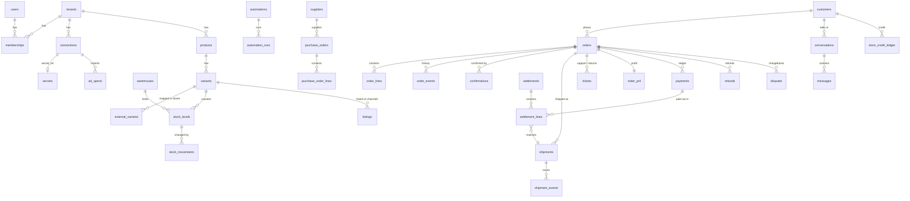

# 04 — Data model

The source of truth is the SQL in **`packages/db/migrations/`** (`0001_core.sql`, `0002_commerce_os.sql`, `0003_app_role.sql`). This page explains it. Tests in `packages/db/test/schema.test.ts` prove that migrations apply, RLS isolates tenants (and is enabled on **every** tenant table), generated columns compute correctly, and gateway transactions cannot be double-counted.

## 1. Conventions

| Rule | Detail |
| --- | --- |
| IDs | `UUID` with `gen_random_uuid()` (built into PostgreSQL 13+) |
| Tenancy | Every business table has `tenant_id UUID NOT NULL` and the `tenant_isolation` RLS policy (FORCE enabled) |
| Money | `BIGINT` minor units + `CHAR(3)` currency. `*_minor` suffix. EGP and SAR have 2 decimals; KWD, BHD, OMR, JOD, IQD have 3 — use a currency table, never assume 100 |
| Time | `TIMESTAMPTZ`, stored UTC; display in `tenants.timezone` |
| External IDs | `TEXT`, unique per `connection_id` |
| Status fields | `TEXT` + `CHECK` constraint (easy to extend in a migration; no Postgres enums) |
| Personal data | ✅ Encrypted at application level (`PiiCipher`, E2-3): `customers.name/phone_e164/email`, `orders.ship_name/ship_phone/ship_line1/ship_line2` hold `pii:v1:…` (AES-256-GCM, per-tenant key in `secrets` via `tenants.settings.piiKeyRef`, AAD = tenant + column). `phone_hash` = HMAC-SHA256(E.164, tenant pepper) for lookups. City, province, country stay in clear for routing and reports |
| Soft delete | Only where the business needs history (`tenants.status = 'deleted'`); otherwise real deletes for privacy requests |
| Migrations | Forward-only, numbered `NNNN_name.sql`; never edit an applied migration |

### Access from code (ADR-0012)

| Piece | Where | Rule |
| --- | --- | --- |
| Query builder | Kysely, typed by `packages/db/src/schema.ts` | Generated: run `npm run codegen -w @mizan/db` after every migration (a test fails if stale) |
| Tenant scope | `withTenant(db, tenantId, fn)` / `Database.tenant()` in the API | Transaction with `SET LOCAL ROLE mizan_app` + `set_config('app.tenant_id', …, true)`; RLS filters every query |
| Platform scope | `withoutTenant` / `Database.platform()` | App role, no tenant: tenant tables return nothing; for tenants/users lookups. With `setActingUser(trx, userId, { email?, phone? })` the `member_self_read` policy (0004) shows that user's own memberships, and `invitee_read` (0005) their pending invitations by verified email / phone (read-only) |
| Owner access | `Database.kysely` | Migrations and signup bootstrap only |
| Migrations | `mizan-db migrate` (`DATABASE_URL_MIGRATOR`) | One transaction per file, checksums, advisory lock; PGlite dev/test databases migrate at boot |
| Engine state | `mz_inbound_events`, `mz_outbox`, `mz_records` (0001, tenant-scoped by 0008; no personal data since 0025, E2-8; ✅ store-scoped by 0032, E2-7) | Engine `SqlStore` with `tenantQueryClient`: every key unique per tenant and store (`scope` = the Shopify connection id; rows written before belong to the tenant's first store); jobs carry `connection_id` |
| BIGINT | Parsed to JS `bigint` (pg and PGlite) | Never `number`: KWD amounts in fils pass 2^53 sooner than you think |

Canonical (engine) money is a decimal **string** (`"1150.00"`). Convert at the boundary: `toMinor("1150.00", "EGP") = 115000`. The helpers live in `packages/shared/src/money.ts` (`toMinor`, `fromMinor`, `currencyDecimals`, `addMoney` …), tested for 0, 2, 3 and 4 decimal currencies. They never round: an amount with more decimals than its currency allows is rejected.

## 2. Entity map

## 3. Tables by module

| Module | Tables |
| --- | --- |
| Platform | `product_events` (0015: docs/02 §8, ids only; milestones carry `dedupe_key` so they are recorded once), `tenants`, `users`, `memberships`, `api_keys`, `connections`, `secrets`, `domain_events`, `audit_log`, `privacy_requests`, `shopify_installs` (pending OAuth installs before they are claimed into a store: no tenant yet, worker role only, token sealed; 0013). `connections.config.sync` (E7-7, Shopify stores): `{ progressEvents, markPaidOnDelivery, tagReturned, tagLost }` booleans, missing = on. `privacy_requests` gained `connection_id`, `dedupe_key` (unique per tenant), `result` (encrypted export) in 0014; `orders.pii_redacted_at` and `customers.redacted_at` mark redacted rows ; ✅ 0043 (A-1): `platform_staff` (one per user; role `super_admin`\|`support`\|`finance`\|`engineer`; active\|disabled), `platform_audit` (append-only staff trail: route or action, outcome, status, target, `store_id`), role `mizan_platform` (staff tables, read-only store metadata across stores; not orders, customers, secrets); ✅ 0044 (A-2): the platform role may change `tenants.plan`/`status`, append to any store's `audit_log` only as `actor_type = mizan_staff` (never read it), and keeps `platform_store_notes` (internal notes per store, 1–2000 chars; the app role cannot read them); ✅ 0045 (A-3): `support_access` (per store: staff, mode `read`\|`write`, reason, `expires_at` at most 8 h after start, `ended_at`/`ended_by` staff\|store). RLS: the store reads its grants and may only end one; the platform role opens and ends them; ✅ 0046 (A-5): `users.disabled_at` + `disabled_reason` (set together; only the platform role may change them), index on `lower(email)`; ✅ 0047 (A-6): `feature_flags` (key, description, `enabled` for everyone), `feature_flag_stores` (per store setting, RLS), `announcements` (level, AR/EN title and body, https link, optional plans and countries, window); stores read them, only the platform role writes |
| Engine | `mz_inbound_events`, `mz_outbox`, `mz_records` (same as `packages/engine/src/sync/sql-store.ts`, plus `tenant_id`) |
| M1 Orders | `orders` (incl. `channel`, `payment_mode`, `payment_status`, `paid_minor`, `refunded_minor`, `balance_minor`), `order_lines`, `order_events`, `customers`, `external_variants`. ✅ 0016 (E5-1): `orders.customer_label` (first name + last initial, encrypted), `orders.phone_last4`; indexes `orders_recent` (tenant, placed_at desc, id desc) and `orders_number` (tenant, lower(number)) for the list |
| M2 Confirmation | `confirmations`, `orders.risk_score`, `orders.confirm_route`. ✅ 0018 (E6-7): `confirmation_runs` (one live run per order: `running` or `needs_agent`; `plan` = the cascade when it started; outcome, answered channel, link expiry), `confirmation_steps` (the module's outbox: one row per send and per wait, `run_at`, lease, attempts, `(tenant_id, idempotency_key)` unique; the worker may read only tenant, time, status and lease), `confirmations` + `run_id`, channels `link`, `voice_ivr`, `voice_ai`, `agent`, outcome `no_reply`; `notes` encrypted (customer's change request) |
| M3 Shipping | `shipments`, `shipment_events`. ✅ 0039 (E7-1): `shipments.booking` (`pending` while the courier job runs, `booked` with the tracking number, `failed` with `error_code` + `error`), `tracking_url`, `requested_by`, `booked_at`; `shipments_one_live` keeps one live outbound booking per order (a failed or cancelled one can be booked again). `cod_minor` is `cashToCollect(order)` at request time, then what the courier recorded. ✅ 0040 (E7-3): `shipments_recent`, `shipments_review` (needs review or a refused booking), `shipment_events_shipment`, `shipment_events.actor_id` (who set it, for `ops`) ✅ 0048 (E7-2): `bulk_actions.action` also takes `ship` (bulk ship from the shipping screen) |
| M4 Warehouse | `products`, `variants`, `warehouses`, `stock_levels`, `stock_movements`. ✅ 0015: `products.connection_id` + `external_id` (unique: a store product is projected once, updated after); `variants.cogs_set_at` (null = cost never entered; `cogs_minor` 0 can be a real cost). Store syncs never touch costs. ✅ 0029 (E8-1): `variants.barcode_set_at` (null = the barcode follows the store; set = Mizan owns it and syncs leave it), unique `variants_barcode` (tenant, barcode) where not null (a scan finds one variant; a store barcode another variant has is not copied), `products_title` index for the list. `external_variants.last_seen.barcode` keeps the store's barcode to give back ✅ 0030 (E8-2): a variant is counted by Mizan once it has a `stock_levels` row; `orders.stock_status` (`reserved`, `short`, `untracked`, null when not confirmed) with `orders_stock_short`; `stock_movements.detail` (count, or the adjust reason), `note`, `seq` (write order, also within a transaction), indexes by order and by variant. Levels are kept equal to the sum of the ledger (receive, adjust, pick → on hand; reserve, release → reserved) |
| M5 Profit | `order_pnl`, `cost_rules`, `fx_rates`. ✅ 0017 (E9-1): `cost_rules` versioned (never edited: a change closes the version in force with `valid_to` = day before and adds one; `fixed_minor` for "2.5% + EGP 2", `return_minor` for a courier's return leg; shape checks per kind; `cost_rules_active`). `fx_rates`: one row per (day, base, quote), 1 base = rate quote, fetched daily with base USD (cross rates for other pairs), worker writes. `fx_rate_overrides`: a store's own rate for a day (RLS). Lookup: override > day's rate > latest earlier ≤ 7 days (stale) > missing |
| M6 Returns | `tickets` (✅ 0035: `number` per store `UNIQUE (tenant_id, number)`, fixed `reason` codes, type `refused`, `source`, `created_by`, `due_at`, `closed_at`, `updated_at`), `ticket_events` (the ticket's history: created, status, assigned, updated, note, refund; ordered by `seq`), `return_inspections` (✅ 0037: per order line, `quantity`, `outcome` restock\|damaged\|write_off, who, the ops-app op) ; `exchanges` (✅ 0041, E10-2: original and replacement order, unique per replacement; the items coming back `[{lineId, quantity}]`, `returned_value_minor`, `credit_minor` moved as store credit, `refund_due_minor`, `status` awaiting_return\|returned); ✅ 0042 (E10-4) on `orders`: `partial_items`, `partial_due_minor` (what the customer owes after a partial delivery; `balance_minor` and the ledger measure against it), `partial_at`, `refusal_reason`, `refusal_open_box`, `refused_at` |
| M7 Attribution | `ad_spend`, `orders.utm`, `orders.click_ids` |
| M8 Reconciliation | `settlements` (`source_type`: courier, gateway, bnpl, bank, marketplace), `settlement_lines` (`line_kind`, `payment_id`) |
| M13 / M14 | `automations`, `automation_runs`, `scripts`. ✅ 0033 (E11-1): automations add `description`, `paused_reason` (errors), `created_by`, `runs`, `failures`, `last_run_at`, index on enabled triggers; runs add `version`, `event_type`, `entity_id`, `depth`, `reason`; `notifications` (roles, text, entity, source, dedupe key) and `notification_reads` (per person), RLS |
| M15 Payments | `payments` (signed ledger), `payment_links`, `refunds` (✅ 0036: `number` per store, `requested_by`, `approved_at`, `rejected_at`, `rejection_reason`, `note`, `refund_payment_id` = its line in the ledger), `disputes`, `store_credit_ledger` |
| Billing (E12) | `usage_months` (✅ 0038: a store's month frozen once it ends: orders, WhatsApp messages, AI offers, stores, users, plan; `month` is the first day) |
| M16 Purchasing | `suppliers`, `purchase_orders`, `purchase_order_lines`, `landed_costs` |
| M17 Inbox | `conversations`, `messages` |
| M18 Channels | `listings`; marketplace accounts are `connections` with `kind = 'marketplace'`; marketplace warehouses are `warehouses.type = 'marketplace_fc'` |
| M19 Finance | `expenses`, `accounting_periods`, `tax_documents` |
| M20 / M21 / M22 | `reports`; `webhook_subscriptions`, `webhook_deliveries`; `pos_shifts` (shops are `warehouses.type = 'shop'`, sales are orders with `channel = 'pos'`) |
| Later migrations | M9 segments, campaigns and loyalty tiers; M10 commission rules and payouts; M11 risk network (separate schema, hashed); M12 routing rules; billing |

## 4. Key rules encoded in the schema

- **One order per store order:** `UNIQUE (tenant_id, connection_id, external_id)` on `orders`. Webhooks received twice cannot create two orders.
- **One shipment per tracking number per courier account:** `UNIQUE (connection_id, tracking_number)`.
- **Exactly-once offline scans:** `stock_movements UNIQUE (tenant_id, device_op_id)`. The ops app generates `device_op_id` per scan; replays are ignored. ✅ 0031 (E8-3): `ops_operations` (PK tenant + `op_id`, device, user, type, `status` applied/rejected/conflict, code, result, client and received times) stores each op's first outcome, so a replay returns it unchanged; RLS like every tenant table.
- **Available stock is derived:** `stock_levels.available = on_hand − reserved` (generated column). Never write it.
- **Net profit is derived:** `order_pnl.net_minor` is a generated column. The profit service writes components only.
- **One automation run per event:** `automation_runs UNIQUE (automation_id, event_id)`.
- **Outbox idempotency:** `mz_outbox.idempotency_key UNIQUE`.
- **One ledger line per reference:** ✅ 0034 (E14-1) `payments_ref UNIQUE (tenant_id, kind, external_ref, connection_id) NULLS NOT DISTINCT WHERE external_ref IS NOT NULL`, so a gateway transaction, a store total and a team entry (`manual:<uuid>`) are each written once, with or without a connection (replaces 0002's key, under which lines without a connection could repeat).
- **Ledger lines are signed by kind** (`payments_sign`): authorization, capture, sale, cod_collection and chargeback_reversal positive; refund, chargeback and void negative; never zero. Each line has a `source` (`store`, `gateway`, `courier`, `manual`), an optional `note` and `recorded_by`.
- **The order's money is the ledger's sums** (E14-1, `apps/api/src/modules/payments/ledger.ts`): `paid_minor` = Σ succeeded sale + capture + cod_collection + void; `refunded_minor` = −Σ refunds; written by `LedgerService` in the transaction that adds the line, the order row locked. While an order has only store lines its payment status and `cod_minor` are the store's; once it has others, they follow the sums (a COD or deposit order then collects `total − paid`).
- **Balance is derived:** `orders.balance_minor = max(total − paid, 0)`, what the customer still owes (COD due, deposit balance).

## 5. Profit computation (M5)

`order_pnl` is recomputed by the profit service on every event that touches the order (`order.confirmed`, `shipment.*`, `return.inspected`, `settlement.matched`, ad spend import). Rules:

| Component | Source | When |
| --- | --- | --- |
| `revenue_minor` | Order total (base currency, FX of `placed_at` day) | COD: on delivery. Card/wallet/BNPL: on capture. Bank transfer: on match. Marketplace: on marketplace confirmation. POS: on sale. Refused: 0 |
| `refund_minor` | Σ completed refunds | On `refund.completed` |
| `cogs_minor` | Σ `order_lines.unit_cost_minor × quantity` | On confirm; reversed if restocked after return |
| `shipping_minor` | Settlement fee, else courier rate card (`cost_rules`) | On ship; corrected on settlement |
| `cod_fee_minor` | Settlement, else `cod_fee_pct` | On delivered (COD and deposit balance) |
| `payment_fee_minor` | Gateway or BNPL fee: estimate at capture, actual from payout | Card, wallet, BNPL, deposit |
| `channel_fee_minor` | Marketplace commission and fulfilment fees | Marketplace orders |
| `ads_minor` | Attributed spend (M7); MVP (E9-3): the store's spend that day ÷ its orders placed that day, not cancelled before shipping (refused ones keep their share) | On order placed; re-split when spend or the day's orders change |
| `agent_minor` | `agent_per_order` rule or M10 commission | On confirm |
| `packaging_minor` | `packaging_per_order` rule | On pack |
| `rto_minor` | Return leg fee + write-off value for damaged items | On returned / inspected |
| `chargeback_minor` | Disputed amount + dispute fee | On `dispute.opened`; reversed if won |

`is_final = true` once delivered and settled, or returned and inspected. Dashboards show provisional and final profit separately.

✅ E9-2 (`apps/api/src/modules/profit/pnl.ts`, migration 0019): `order_pnl.day` (the order's store day), `expected_revenue_minor` / `expected_net_minor` (what a still-moving order makes if it delivers, at today's rules), `flags` (`fx_missing`, `cost_missing`, `shipping_rate_missing`, `return_rate_missing`, `cod_fee_missing`, `payment_fee_missing`, `agent_cost_missing`, `packaging_cost_missing`, `estimated`, `awaiting_settlement`). `order_lines.cost_set_at`: the product cost is locked on the line at confirmation, so a later price change never rewrites a confirmed order. A returned order's goods count as restocked until inspection (E10). Without an exchange rate the row stays in the order's currency and costs from rules are not mixed in. Monthly fixed costs are not spread per order: the home (E9-4) spreads each month's amount over its days (a full month adds up exactly) and takes it off the period.

✅ Migration 0020: `order_lines.external_variant_id` (the store's variant id) links each line to `variants` through `external_variants`; a line that arrives before its product is linked when the product is read (`ProductProjector`, then `costs.changed` so its profit counts the cost). `variants.available` / `available_at`: stock as the store last reported it (NULL = unknown), used by offers (E6-11).

✅ Migration 0021 (E6-10): `confirmation_steps` channels `whatsapp | call_auto | call_team` (old `sms`/`voice` rows kept), kind `reply` (a follow-up in the chat, `payload {message}`); `confirmation_runs.chat_state` (`awaiting_change`, `awaiting_reason`), `customer_hash` (phone HMAC: finds the run a typed message belongs to), `call_attempts`, `call_after` (team-call retry); `whatsapp_messages` (the conversation: direction, Meta `wamid` unique per store, kind, action, delivery status, error code, step key; no message text — a typed change is encrypted in `confirmations.notes`). Worker reads `connections.external_account`/`kind` to route Meta's webhooks by phone number id.

✅ Migration 0022 (E6-11): `offer_rules` (trigger variant or any order, offer variant, `discount_pct` 0–50, priority, optional wording, active) and `order_offers` (one per confirmation run: variant, qty, unit and offer price in minor units with `offer_price ≤ unit_price`, discount, source `rule|auto|ai`, status `proposed → accepted|declined|expired → applying → applied|failed`, channel, who decided). Settings in `tenants.settings.offers`. Index `order_lines_variant` for bought-together.

✅ Migration 0023 (E6-12): `confirmation_steps.kind` adds `ai_offer` (payload: the offer id, the order's items and the shortlist with prices and costs; product facts only). Settings `offers.ai`.

✅ E6-13 (no migration): `order_offers.status` moves `accepted → applying → applied|failed` from the engine's `shopify.addOffer` job; `error` keeps the reason (`not_in_store`, `validation`, `not_found`, `permission`, `failed`); `order_events` gets `offer_applied` / `offer_failed`.

✅ Migration 0024 (E9-3): `ad_spend` primary key adds `platform` (one row per store, day, platform, campaign; `campaign_id` empty for a day's total), `source` (`manual`, `csv`, `api`), `updated_at`, `updated_by`, check `spend_minor >= 0` and platform code, index `ad_spend_day`. `connection_id` is the store the ads sold for until ad accounts connect (M7). Flag `ads_fx_missing` on `order_pnl.flags`.

✅ Migration 0026 (E5-3): `orders.duplicate_status` (`suspected`, `kept`, `merged`) with `duplicate_of` (0001) — both or neither, never itself (`orders_duplicate_shape`) — and `duplicate_reason` (products in both, minutes apart, window; no personal data). Indexes `orders_duplicates` (the tab), `orders_customer_recent` (detection). Settings `tenants.settings.orders.duplicateWindowHours`.

✅ Migration 0027 (E5-8): `order_reconciliations` (store connection, store day, `store_orders`, `recovered`, `mizan_orders`, generated `gap`, `checked_at`; one per store and day; RLS).

✅ E6-1 (no migration): `orders.risk_score` 0–100 and `orders.risk_reasons` `[{ code, points }]` (the three reasons that moved it most; codes, never personal data), written when the order is projected.

Cost rules apply by the order's day in the store's time zone (`CostRulesService.resolve`, E9-1); a foreign-currency order converts with the rate of its `placed_at` day (`FxService.toBase`); a missing rate keeps the order's profit provisional and flagged, never guessed.

## 6. Indexes to add with real data

Measure first with `EXPLAIN ANALYZE` on pilot data. Likely candidates: `orders (tenant_id, phone_hash, placed_at)` for duplicate checks; `shipments (tenant_id, tracking_number)`; `order_pnl (tenant_id, is_final)`; trigram index on `orders.number` for search.
