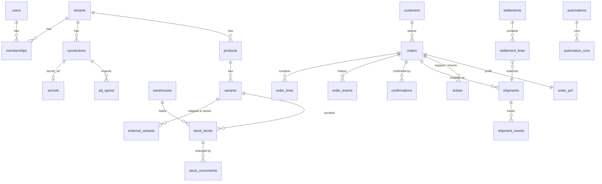

# 04 — Data model

The source of truth is the SQL in **`packages/db/migrations/`**. This page explains it. Tests in `packages/db/test/schema.test.ts` prove that migrations apply, RLS isolates tenants, and generated columns compute correctly.

## 1. Conventions

| Rule | Detail |
| --- | --- |
| IDs | `UUID` with `gen_random_uuid()` (built into PostgreSQL 13+) |
| Tenancy | Every business table has `tenant_id UUID NOT NULL` and the `tenant_isolation` RLS policy (FORCE enabled) |
| Money | `BIGINT` minor units + `CHAR(3)` currency. `*_minor` suffix. EGP and SAR have 2 decimals; KWD, BHD, OMR, JOD, IQD have 3 — use a currency table, never assume 100 |
| Time | `TIMESTAMPTZ`, stored UTC; display in `tenants.timezone` |
| External IDs | `TEXT`, unique per `connection_id` |
| Status fields | `TEXT` + `CHECK` constraint (easy to extend in a migration; no Postgres enums) |
| Personal data | `customers.phone_e164`, names, addresses: encrypted at application level in production (see `docs/07-security-compliance.md`); `phone_hash` for lookups |
| Soft delete | Only where the business needs history (`tenants.status = 'deleted'`); otherwise real deletes for privacy requests |
| Migrations | Forward-only, numbered `NNNN_name.sql`; never edit an applied migration |

Canonical (engine) money is a decimal **string** (`"1150.00"`). Convert at the boundary: `toMinor("1150.00", "EGP") = 115000`. Write that helper once in `packages/shared` with tests for 0, 2 and 3 decimal currencies.

## 2. Entity map

## 3. Tables by module

| Module | Tables |
| --- | --- |
| Platform | `tenants`, `users`, `memberships`, `api_keys`, `connections`, `secrets`, `domain_events`, `audit_log`, `privacy_requests` |
| Engine | `mz_inbound_events`, `mz_outbox`, `mz_records` (same as `packages/engine/src/sync/sql-store.ts`, plus `tenant_id`) |
| M1 Orders | `orders`, `order_lines`, `order_events`, `customers`, `external_variants` |
| M2 Confirmation | `confirmations`, `orders.risk_score`, `orders.confirm_route` |
| M3 Shipping | `shipments`, `shipment_events` |
| M4 Warehouse | `products`, `variants`, `warehouses`, `stock_levels`, `stock_movements` |
| M5 Profit | `order_pnl`, `cost_rules`, `fx_rates` |
| M6 Returns | `tickets` |
| M7 Attribution | `ad_spend`, `orders.utm`, `orders.click_ids` |
| M8 Cash | `settlements`, `settlement_lines` |
| M13 / M14 | `automations`, `automation_runs`, `scripts` |
| Later migrations | M9 segments and campaigns, M10 commission rules and payouts, M11 risk network (separate schema, hashed), M12 routing rules, billing |

## 4. Key rules encoded in the schema

- **One order per store order:** `UNIQUE (tenant_id, connection_id, external_id)` on `orders`. Webhooks received twice cannot create two orders.
- **One shipment per tracking number per courier account:** `UNIQUE (connection_id, tracking_number)`.
- **Exactly-once offline scans:** `stock_movements UNIQUE (tenant_id, device_op_id)`. The ops app generates `device_op_id` per scan; replays are ignored.
- **Available stock is derived:** `stock_levels.available = on_hand − reserved` (generated column). Never write it.
- **Net profit is derived:** `order_pnl.net_minor` is a generated column. The profit service writes components only.
- **One automation run per event:** `automation_runs UNIQUE (automation_id, event_id)`.
- **Outbox idempotency:** `mz_outbox.idempotency_key UNIQUE`.

## 5. Profit computation (M5)

`order_pnl` is recomputed by the profit service on every event that touches the order (`order.confirmed`, `shipment.*`, `return.inspected`, `settlement.matched`, ad spend import). Rules:

| Component | Source | When |
| --- | --- | --- |
| `revenue_minor` | Order total (base currency, FX of `placed_at` day) | COD: on `delivered`. Prepaid: on paid. Refused: 0 |
| `cogs_minor` | Σ `order_lines.unit_cost_minor × quantity` | On confirm; reversed if restocked after return |
| `shipping_minor` | Settlement fee, else courier rate card (`cost_rules`) | On ship; corrected on settlement |
| `cod_fee_minor` | Settlement, else `cod_fee_pct` | On delivered |
| `payment_fee_minor` | PSP fee | Prepaid orders |
| `ads_minor` | Attributed spend (M7); MVP: daily spend ÷ delivered orders that day, per store | Daily job |
| `agent_minor` | `agent_per_order` rule or M10 commission | On confirm |
| `packaging_minor` | `packaging_per_order` rule | On pack |
| `rto_minor` | Return leg fee + write-off value for damaged items | On returned / inspected |

`is_final = true` once delivered and settled, or returned and inspected. Dashboards show provisional and final profit separately.

## 6. Indexes to add with real data

Measure first with `EXPLAIN ANALYZE` on pilot data. Likely candidates: `orders (tenant_id, phone_hash, placed_at)` for duplicate checks; `shipments (tenant_id, tracking_number)`; `order_pnl (tenant_id, is_final)`; trigram index on `orders.number` for search.
